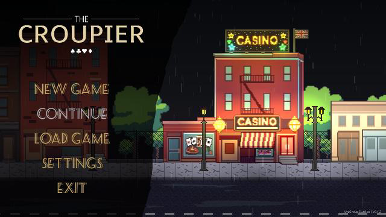
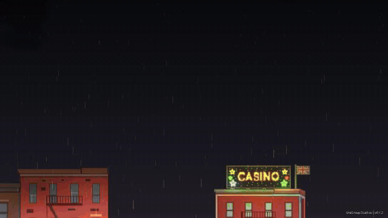
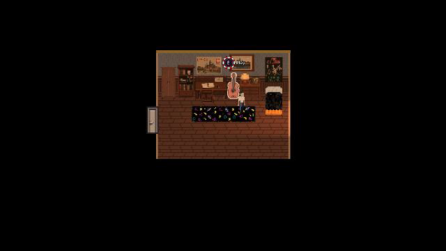
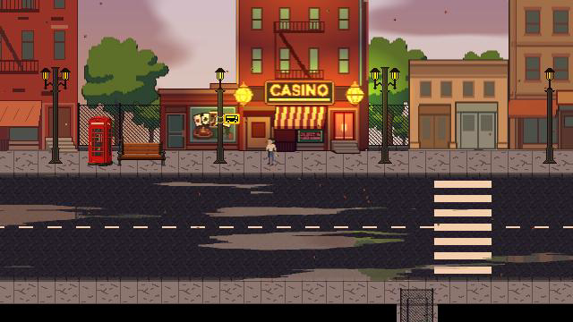
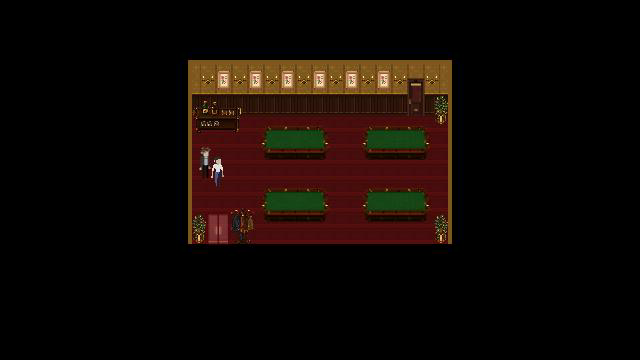
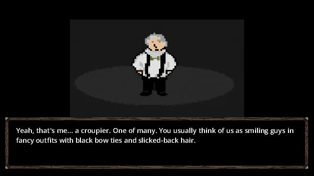

# The Croupier

**Work in progress — zespołowy projekt gry w trakcie rozwoju.**

Gra 2D rozwijana w **Godot**, łącząca eksplorację, historię, dialogi i interakcje z otoczeniem. Projekt obejmuje m.in. ulice miasta, wnętrza domów i kasyno, z własną oprawą wizualną i dźwiękową.

To repozytorium prezentuje **mój udział w projekcie i materiały portfolio**. Gra powstaje zespołowo w **UniGroup Studios**; źródła wspólnego projektu są rozwijane w [oryginalnym repozytorium na GitLabie](https://gitlab.com/unigroup-studios/the-croupier).

## Mój wkład — Dominik Zaręba

- **Level design:** projektowanie i opracowywanie scen oraz przestrzeni gry.
- **Historia:** współtworzenie fabuły, dialogów i narracji.
- **Mechaniki:** tworzenie mechanik rozgrywki i interakcji z otoczeniem.
- **Implementacja:** wdrażanie mechanik oraz elementów gry w Godot i GDScript.
- **Muzyka:** tworzenie i opracowywanie muzyki do gry.

## Zobacz projekt w ruchu

[**Pobierz nagranie z dźwiękiem — MP4**](docs/video/gameplay.mp4)

GIF i film są krótkim montażem ujęć z uruchomionej wersji roboczej: menu głównego, pokoju Iana, ulicy i kasyna. Pokazują przegląd scen projektu oraz ruch postaci.

## Ujęcia z projektu

| Pokój Iana | Ulica |
| --- | --- |
|  |  |

| Kasyno | Wprowadzenie do historii |
| --- | --- |
|  |  |

## Elementy projektu

- Eksploracja scen 2D i przechodzenie między lokalizacjami.
- Interakcje z obiektami i postaciami, podpowiedzi dla gracza i dialogi.
- Fabuła, stan postępu, zapis i odczyt gry.
- Oprawa środowiska: światła, pogoda, dźwięki i muzyka.
- Menu główne i ustawienia.

## Technologie

**Godot 4.6 · GDScript · sceny i TileMap 2D · shadery · Git**

## Stan i autorstwo

Projekt jest **work in progress**. Przedstawione materiały dokumentują etap rozwoju; wygląd i mechaniki mogą się zmieniać. Gra powstaje wspólnie w UniGroup Studios; powyżej opisuję obszary mojej pracy.

**Repozytorium źródłowe zespołu:** [UniGroup Studios / The Croupier](https://gitlab.com/unigroup-studios/the-croupier).
